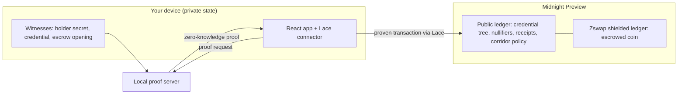

<p align="center">
  <picture>
    <source media="(prefers-color-scheme: dark)" srcset="frontend/public/brand/logo.svg" />
    
  </picture>
</p>

<h1 align="center">ZK Remit</h1>
<p align="center"><b>Private, compliant cross-border remittances on Midnight.</b><br/>Prove you're compliant. Reveal nothing else.</p>

<p align="center">
  <a href="https://cyptoboy777.github.io/zk-remit/">Live app</a> ·
  <a href="#demo-video">Demo video</a> ·
  <a href="#deployed-on-midnight-preview">Contract on Preview</a> ·
  <a href="#check-it-in-five-minutes">Test it</a> ·
  <a href="SECURITY.md">Security</a> ·
  <a href="docs/AKINDO_SUBMISSION.md">Wave 3 submission</a>
</p>

<p align="center">
  
  
  
  
  
</p>

## Judge quick-verify

| What | Link |
| --- | --- |
| Live app | https://cyptoboy777.github.io/zk-remit/ |
| Contract on Preview | `0baf0281028181bf6d53c9f1ff37109252202244fe861cea2d90e132ee8615d3` · [explorer](https://preview.midnightexplorer.com) (search the address) |
| On-chain proof and indexer output | [PROOF.md](PROOF.md) |
| Quality and engineering results | [docs/WAVE3-RESULTS.md](docs/WAVE3-RESULTS.md) |
| Slide deck (PDF) | [docs/ZK-Remit-slides.pdf](docs/ZK-Remit-slides.pdf) |
| Explainer video | [docs/zk-remit-explainer.mp4](docs/zk-remit-explainer.mp4) |

---

## The problem

Sending money abroad forces a bad trade. To satisfy KYC and corridor limits, operators collect and copy
sensitive identity and amount data across many systems. Every copy is a breach waiting to happen, and
the people who pay for it are mostly migrant workers sending a few hundred dollars home.

## What ZK Remit does

A sender proves, in zero knowledge, that a transfer is **KYC-attested, inside licensed limits, on an approved corridor and under their epoch quota**. Then the settlement value moves into a **shielded escrow** held by the contract. The recipient claims with a link or QR code. If nobody claims, the sender reclaims after the corridor's claim window.

| The public ledger sees | Nobody but the parties sees |
| --- | --- |
| The corridor (from and to country) | Name and identity |
| An amount **band**, never the amount | Exact amount |
| A one-time nullifier and blinded tags | KYC tier and which issuer attested |
| Receipt status: pending, claimed, refunded | Who the recipient is |

A regulator or auditor can still check one receipt: the sender proves ownership of it to a single challenge (selective disclosure) without revealing anything else.

## Demo video

<!-- DEMO_VIDEO: replace this comment with the line below once the URL is known
[](VIDEO_URL)
-->
The demo follows [`docs/VIDEO_SCRIPT.md`](docs/VIDEO_SCRIPT.md): issue a credential, send with a proof, open the claim link, then show what the ledger and an auditor can and cannot see.

## Deployed on Midnight Preview

Every value below is copied from [`frontend/src/deployment.json`](frontend/src/deployment.json), which the deploy script writes. Nothing is invented.

<!-- deployment:start -->
| Item | Value |
| --- | --- |
| Network | Midnight Preview (ledger 9) |
| Contract address | `0baf0281028181bf6d53c9f1ff37109252202244fe861cea2d90e132ee8615d3` |
| Deploy transaction | `0cdd84e2a98028f3d50972140f9eb75f696ee2903225486bd7876991e4141bad` |
| Deployed | 2026-11-24 |
| Seed transactions | 9 (demo issuer, corridors, Preview test funds) |
| Explorer | https://preview.midnightexplorer.com (search the address) |
<!-- deployment:end -->

Anyone can confirm the contract exists without a wallet: `node scripts/verify-deployment.mjs` asks the public Preview indexer for it.

## Check it in five minutes

```bash
npm install
npm test                             # 46 contract tests + 46 frontend tests, no network or wallet
npm run dev -w frontend              # Simulator mode: the same compiled circuits, in your browser
node scripts/verify-deployment.mjs   # finds our contract on the public Preview indexer
node scripts/mutation.mjs            # deletes each contract guard; a test must fail each time (needs compactc)
```

**On Midnight Preview:** open the app, switch to **Midnight Preview**, connect Lace, press **Get test funds**, then **Send**. Proof generation takes up to about a minute. Open the claim link in a second wallet to claim. If Lace's *Generate tDUST* fails (a known Lace 2.5.2 bug), run `npm run dust:register`.

| Judge ask | Where to look |
| --- | --- |
| Compact contract compiles, 12 circuits | [`contract/src/zk-remit.compact`](contract/src/zk-remit.compact) |
| Dual-ledger use (public state plus Zswap shielded coin) | [Midnight integration](#midnight-integration) |
| Private-state management | [`secureStore.ts`](frontend/src/lib/secureStore.ts), [`witnesses.ts`](contract/src/witnesses.ts) |
| Tests and reliability | [Quality](#quality) |
| Frontend connected end to end | Send, Claim, Auditor tabs; [`midnightBackend.ts`](frontend/src/lib/midnightBackend.ts) |
| What changed since Wave 2 | [Changelog](#what-changed-in-wave-3) |
| Security review | [SECURITY.md](SECURITY.md) |
| Business model | [Who pays](#who-pays) |

## Midnight integration



**Dual ledger, on purpose.** Eligibility, quota and status live in public contract state as hashes and counters. The money never appears there: it sits in a shielded coin the contract takes with `receiveShielded` and releases with `sendShielded` to the claimer's wallet. The chain stores a coin commitment and, once spent, a nullifier.

**What `sendRemittance` proves**

| # | Statement | Stays private | Disclosed |
|---|---|---|---|
| 1 | Credential leaf is in a historic credential tree | credential, Merkle path | root |
| 2 | Credential is bound to the holder | holder secret | nothing |
| 3 | Issuer is still in the active-issuer tree | which issuer | issuer-tree root |
| 4 | Credential not expired | expiry | nothing |
| 5 | Corridor is open and policy applies | KYC tier | corridor, band |
| 6 | Amount is within the tier cap for the corridor | exact amount | band only |
| 7 | Epoch quota available, nullifier fresh | slot-to-holder link | nullifier |
| 8 | Shielded coin escrowed | coin nonce | escrow commitment |

**Private state, held by witnesses on the device**

| Witness | Holds | Bound on chain by |
|---|---|---|
| `holderSecret` | sender's secret key | must match the credential's holder key; derives nullifier and view key |
| `heldCredential` | tier, country, issuer, expiry, salt | `persistentHash` leaf proven in the credential tree |
| `issuerPath` / `credentialPath` | Merkle paths | `merkleTreePathRoot` checked against historic roots |
| `recipientSecret` | a fresh secret per transfer, carried only in that claim link's `#fragment` | `recipientTagOf(secret)` equals the receipt's tag |
| `escrowSalt` / `escrowOpening` | coin opening and its real tree index | `persistentCommit` equals the receipt's `escrowCommit` |
| `governorSecret` / `issuerSecret` | operator keys | hashed and compared with `governorPk` / issuer tree |

**Public contract state:** `governorPk`, issuer-tree root, credential-tree root, `revokedIssuers`, `corridorPolicy`, `epoch`, `nullifiers`, and one `Receipt` per transfer (corridor, amount band, epoch, escrow commitment, recipient tag, view tag, status), plus aggregate counters.

**Twelve circuits:** `addIssuer`, `revokeIssuer`, `issueCredential`, `setCorridorPolicy`, `closeCorridor`, `advanceEpoch`, `enableTestMint`, `mintTestSettlement`, `sendRemittance`, `claim`, `reclaim`, `proveReceiptOwnership`.

**The escrow tree index.** Spending a contract-held coin needs its position in Zswap's coin tree, which exists only after the send is applied. Writing the coin with `writeCoin` would hand us the index but publish the exact amount, so we did not. Instead the app recomputes the coin commitment for (coin, this contract) and finds that leaf in the Zswap state the indexer returns ([`escrowIndex.ts`](frontend/src/lib/escrowIndex.ts), tested against the real ledger WASM). Outcomes are found, not yet confirmed, or unreadable; the last two stop before any fee is spent and the sender can still reclaim after the window.

**Preview-only test funds.** The Preview faucet issues unshielded tNIGHT, but escrow needs a shielded token. So `mintTestSettlement` exists, capped at 1000.00 per call, inert until the governor calls `enableTestMint()`. A production deployment would never enable it. Those tokens are demo tokens, not money.

## Quality

| Check | Result |
| --- | --- |
| Contract tests (Compact runtime simulator) | 46, all asserting ledger state, including a security test per audit finding |
| Frontend tests | 46: secure storage, claim links, privacy matrix, CSP, deployment loading, error copy |
| Guard mutation check | Every `assert()` in the contract is deleted in turn and recompiled; a test must fail. **33 of 33 reachable guards caught.** One unreachable guard is documented in [`mutation-allowlist.json`](contract/mutation-allowlist.json) |
| Browser smoke test | Playwright runs the app under the shipped CSP in CI |
| Lighthouse (mobile, CI) | Performance 96 (home) and 97 (claim link); accessibility, best practices and SEO 100 |
| On-chain check | `verify-deployment.mjs` finds our `ContractCall` on the Preview indexer in CI |

## Security

A full review is in [SECURITY.md](SECURITY.md): 10 contract findings and 7 frontend and tooling findings, each with a fix or an honest status and a test.

- Secrets are sealed at rest with AES-GCM using a non-extractable WebCrypto key in IndexedDB; with no crypto available they stay in memory, never plaintext.
- The claim secret lives only in the URL fragment, is strictly validated, and is scrubbed from memory and the address bar after use.
- A fresh recipient secret per transfer keeps public tags unlinkable.
- A strict Content-Security-Policy ships as a meta tag and as headers; a test keeps them identical.

**Known limits, stated plainly:** issuer revocation is not enforced at send time (C1), and the governor can lengthen the claim window for pending escrows (C2). Both need a contract redeploy and are listed with their fixes in SECURITY.md. Claim and reclaim rely on an indexer lookup because Midnight.js 5 has no official commitment-index API.

## What changed in Wave 3

Compared with the `wave2-baseline` tag.

| | `wave2-baseline` | Wave 3 |
|---|---|---|
| Value movement | Compliance receipts only | **Shielded escrow** via `receiveShielded` / `sendShielded` |
| Circuits | 7 | **12** |
| Corridors | Open or closed | On-chain **`CorridorPolicy`**: caps, slots, max band, claim window |
| Issuers | One issuer, also admin | **Multi-issuer** tree with revocation |
| Claim | Manual amount opening | **Claim link / QR** with a per-transfer secret |
| Privacy UX | None | **Who sees what** explorer, disclosure preview, anonymity-set meter, Privacy Simulator |
| Security | None | Audit, encrypted device storage, CSP, a test per finding |
| Quality | Basic tests | 92 tests, guard mutation check, Playwright smoke test, Lighthouse in CI |
| Networks | Simulator | Simulator and **Midnight Preview** with Lace, plus a CLI path for tDUST |
| Languages | English | EN, ES, PT, ZH, FR |

## Product and business viability

**Who it is for.** Cross-border freelancers who want to be paid abroad without exposing income and identity to every intermediary; SMEs paying overseas suppliers or contractors who must show limits and licence terms without sharing their books; and licensed remittance operators on corridors such as UAE to Philippines, USA to Mexico, Saudi Arabia to Pakistan and UK to Nigeria. The World Bank's Remittance Prices Worldwide puts the average cost of sending money at 6.36 percent of the amount sent, so the market already pays for this service.

**Why selective auditor disclosure makes it commercially viable.** A payment operator cannot adopt a privacy product that its regulator cannot inspect. ZK Remit's sender can prove to an auditor that one specific receipt is theirs, bound to that auditor's challenge, and reveal nothing else. Corridor limits, per-tier caps and claim windows are enforced by the contract, and licensed issuers attest customers once. That lets an operator show compliance without keeping a customer database that can leak, which is what a compliance review asks for.

**Who pays.** Operators, through a small per-transfer fee and a per-credential fee. Status: no partners, users or revenue yet and no measured fee; the next step is one operator on one corridor in a sandbox.

## Who pays (detail)

ZK Remit is infrastructure for licensed remittance operators (money transfer operators, e-money issuers, remittance fintechs) on corridors such as UAE to Philippines, USA to Mexico, Saudi Arabia to Pakistan and UK to Nigeria.

- **Operators pay**, not senders: a small per-transfer protocol fee, a fraction of the operator's own fee, plus a per-credential fee when their KYC desk issues a reusable attestation.
- **Why they would:** they already pay for KYC and monitoring. Proving limits on chain while keeping customer data off it lowers breach exposure and allows credential reuse across operators.
- **Regulators and auditors** get public receipt fields and consent-based disclosure, which is what a partner needs to clear compliance review.
- **Path:** one licensed operator, one corridor, in a sandbox, issuing credentials from its existing KYC flow; then more corridors through `setCorridorPolicy`.

**Status:** there are no partners, users or revenue yet. This is the intended model, not traction.

## Toolchain (ledger 9)

Midnight Preview relaunched as a ledger 9 chain on 7 Nov 2026, so the whole stack moved together.

| Component | Pin |
|---|---|
| compactc | 0.36.1 (language 0.28.0) |
| compact-runtime | 0.21.0 |
| Midnight.js | 5.0.1 |
| Wallet SDK (deploy script) | 2.0.1 |
| DApp Connector API (Lace) | 4.1.0 |
| Proof server | 9.0.2 (never `:latest`) |

## Develop and deploy

```bash
./scripts/install-compactc.sh
export PATH="$HOME/.local/compactc-0.36.1:$PATH"
npm ci
npm run compact -w contract     # compile the contract
npm test -w contract
npm run build -w frontend
npm run dev -w frontend
```

- **Deploy to Preview** (operator laptop only): [`docs/DEPLOY_PREVIEW.md`](docs/DEPLOY_PREVIEW.md). `npm run deploy:preview:all` checks the toolchain, proof server and tDUST, deploys, seeds a demo issuer, 7 corridors and test funds, then fills the Deployment table above. Wallet phrases live in an untracked `.env` and are never printed.
- **Host the frontend:** GitHub Pages is built by CI; `vercel.json` also holds a complete Vercel setup with the CSP headers.
- **Operator flow in the app:** Issuer tab, paste operator keys (kept in this browser only), then **Issue my credential**.

## Judge checklist

- [x] Compact compiles (0.36.1, ledger 9) with witnesses, commitments, Merkle trees and shielded coins
- [x] Contract deployed on Preview, verifiable without a wallet
- [x] Frontend calls the circuits and reads the ledger end to end
- [x] 46 + 46 tests, mutation check, browser smoke test, Lighthouse, all in CI
- [x] Security review with a test per finding
- [x] Privacy table and in-app disclosure preview
- [x] Apache-2.0, public repo, topic `midnightntwrk`

## License and attribution

Apache-2.0. Built on [Midnight](https://midnight.network): Compact, Midnight.js, the Wallet SDK, the DApp Connector API and Lace. Wave 3 contract and app code is newly developed or materially extended during the wave relative to `wave2-baseline`.
