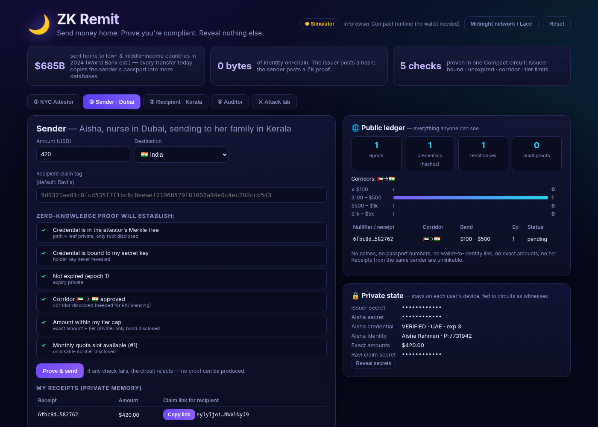
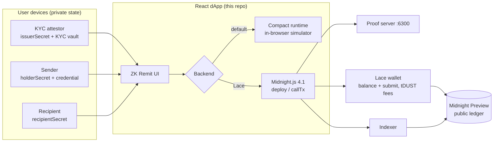

# 🌙 ZK Remit — private, compliant remittances on Midnight

> **Send money home. Prove you're compliant. Reveal nothing else.**

ZK Remit lets a migrant worker prove — in zero knowledge — that a cross-border transfer is
**KYC-verified, within their licensed limits, on an approved corridor and under their monthly
quota**, without putting their name, passport, tier, exact amount or a linkable identity on-chain.
A licensed KYC attestor publishes only a *hash* of each credential; the sender publishes only a
ZK proof plus the minimum a regulator needs (corridor + amount band). The recipient claims with
their own secret; auditors get **opt-in, sender-controlled** selective disclosure.

- **Live demo (GitHub Pages):** https://cyptoboy777.github.io/zk-remit/
- **Contract:** [`contract/src/zk-remit.compact`](contract/src/zk-remit.compact)
- **Tests:** [`contract/src/test/zk-remit.test.ts`](contract/src/test/zk-remit.test.ts) — 12 passing
- **Submission text:** [SUBMISSION.md](SUBMISSION.md) · **60 s demo script:** [DEMO_SCRIPT.md](DEMO_SCRIPT.md) · **Slides:** [PDF](docs/ZK-Remit-slides.pdf) ([source](SLIDES.md)) · **Build notes:** [NOTES.md](NOTES.md)



## Why

Remittances to low- and middle-income countries were about **$685B in 2024** (World Bank estimate),
and India is the largest receiving market. Every transfer today copies the sender's passport,
address and salary data into the databases of an exchange house, a correspondent bank, a payout
partner and often a stablecoin on-ramp — and on public chains the whole payment graph is visible
forever. Regulators don't actually need *who you are* on every hop; they need assurance that a
licensed party did KYC, limits were respected, sanctioned corridors were blocked, and that they can
audit a specific person **when legally required**. That is exactly Midnight's selective-disclosure model.

## What's proven in one Compact circuit (`sendRemittance`)

| # | Statement proven in ZK | What stays private (witness) | What is disclosed |
|---|---|---|---|
| 1 | Credential is a leaf of the issuer's `HistoricMerkleTree` | credential, Merkle path | the tree root only |
| 2 | Credential is bound to the sender's secret key | holder secret & public key | — |
| 3 | Credential not expired for the current compliance epoch | expiry epoch | — |
| 4 | Sender's KYC country + destination is an approved corridor | — | corridor (e.g. 🇦🇪→🇮🇳) |
| 5 | Amount > 0 and ≤ the tier's per-transfer cap | exact amount, tier | amount **band** |
| 6 | Sender has quota left: `slot < tierSlots(tier)` and the `(holder, epoch, slot)` **nullifier** is unused | slot↔holder link | an unlinkable nullifier |

The receipt stores a **commitment** to the exact amount (opened only to the recipient), the
recipient's **claim tag**, and a **view tag** usable only with the sender's view key.

### Other circuits

| Circuit | Who | Purpose |
|---|---|---|
| `constructor(issuerPk)` | deployer | sets the KYC attestor key, epoch 1, band counters |
| `issueCredential(commitment)` | issuer (proves knowledge of issuer secret) | adds a credential hash to the tree |
| `openCorridor / closeCorridor(from, to)` | issuer/operator | licensed corridor allow-list |
| `advanceEpoch()` | issuer/operator | new compliance window: expiries bite, quotas reset with fresh nullifiers |
| `claim(receiptId, amount, salt)` | recipient | proves claim-key ownership + amount opening; marks claimed once |
| `proveReceiptOwnership(receiptId, challenge)` | sender → auditor | proves one receipt is theirs, bound to an auditor challenge, revealing nothing else |
| Off-chain **view key** (`viewKeyOf`) | sender → auditor | lets a court-ordered auditor list *exactly* that sender's receipts; cannot send or claim |

### Midnight dual-ledger model in practice

- **Public ledger state:** issuer key, credential tree root/history, corridors, nullifiers, receipts
  (corridor · band · epoch · commitments/tags), aggregate band volumes, audit-proof hashes.
- **Private state (per device, via witnesses):** `issuerSecret`, `holderSecret`, `credential`,
  `recipientSecret` — see [`contract/src/witnesses.ts`](contract/src/witnesses.ts). In the dApp it is
  stored per contract address by a browser private-state provider and never leaves the device.
- Every value that crosses from private to public is wrapped in an explicit `disclose(...)` — the
  compiler rejects the contract otherwise.

## Architecture



## Repo layout

```
contract/                 Compact contract + TS witnesses + simulator + vitest suite
  src/zk-remit.compact    the contract
  src/witnesses.ts        private state type & witness implementations
  src/simulator.ts        ZkRemitSimulator (compiled circuits on the official compact-runtime)
  src/test/               12 tests: happy path, forgery, theft, limits, corridors, quotas, expiry, claims, audits
frontend/                 React 19 + Vite 8 dApp (simulator mode + Lace/Midnight.js mode)
scripts/install-compactc.sh  installs the official compactc release
.github/workflows/        CI (compile with compactc 0.31.1 and 0.35.0, test, build) + GitHub Pages deploy
```

## Run it locally

Requirements: Node ≥ 22 (24 recommended), Linux/macOS.

```bash
./scripts/install-compactc.sh 0.31.1              # official compiler from midnightntwrk/compact releases
export PATH="$HOME/.local/compactc-0.31.1:$PATH"
npm install
npm run compact                                   # compactc → contract/src/managed/zk-remit (7 circuits, ZK keys)
npm test                                          # 12 vitest tests on the Compact runtime
npm run dev                                       # http://localhost:5173
```

(`compact` devtools users can equally run `compact update 0.31.1 && compact compile contract/src/zk-remit.compact contract/src/managed/zk-remit`.)

### Verified output

```
$ compactc --version          → 0.31.1   (language 0.23.0, runtime 0.16.0)
$ compactc src/zk-remit.compact src/managed/zk-remit
Compiling 7 circuits:          (≈25 s, prover keys: sendRemittance 10 MB, others 2.8–5.2 MB)
$ npm test
 ✓ initialises with the issuer key, epoch 1 and empty registries
 ✓ only the issuer can publish credentials, open corridors or advance epochs
 ✓ a KYC-verified sender remits privately: only corridor, band, nullifier and blinded tags hit the ledger
 ✓ rejects senders without an issued credential (forged credential)
 ✓ rejects a stolen credential used with a different secret
 ✓ rejects amounts above the private tier cap
 ✓ rejects unapproved corridors and closed corridors
 ✓ rate-limits with unlinkable nullifiers: one per (holder, epoch, slot), max tierSlots per epoch
 ✓ rejects expired credentials after the compliance epoch passes
 ✓ only the intended recipient can claim, once, with the correct amount opening
 ✓ selective disclosure to auditors: prove one receipt, or hand over a view key to list all of them
 ✓ BASIC tier caps at $200 and 3 transfers per epoch
 Tests  12 passed (12)
```

The same source also compiles unchanged with **compactc 0.35.0** (language 0.27, runtime 0.20 /
ledger 9) — checked in CI so the project is ready for the next network upgrade.

## Using the live demo

The hosted demo defaults to **Simulator mode**: the real compiled circuits run in your browser on
`@midnight-ntwrk/compact-runtime`, enforcing every `assert` exactly as proving would (proof
generation and chain submission are skipped). Walk the tabs: ① issue a credential & open the
UAE→India corridor → ② send → ③ claim → ④ audit → ⚔ attack lab (7 attacks, all rejected by circuit
assertions). The right side always shows the **public ledger** next to the **private state**.

### Midnight network mode (Lace)

1. Install the Lace wallet with Midnight support, switch it to **Preview**, set its proof server to
   `http://localhost:6300` and run the proof server: `docker run -p 6300:6300 midnightntwrk/proof-server:8.1.3`.
2. Fund the wallet with tNIGHT from the Preview faucet (https://midnight-tmnight-preview.nethermind.dev/)
   and generate tDUST in Lace (fees).
3. In the dApp click **Midnight network / Lace → Connect Lace → Deploy new contract** (or **Join**
   an address). All tabs now generate real proofs (keys are served from `/keys` and `/zkir` on
   GitHub Pages) and submit transactions through Lace.

Network mode uses Midnight.js 4.1.1 + DApp Connector API 4.x, the stack listed in Midnight's
compatibility matrix for Preview/Preprod (compactc 0.31.1, runtime 0.16.0, ledger 8).

## Known limitations (honest scope)

- Corridor origin country and amount band are public by design (FX/licensing + risk analytics); band 3 implies a high tier.
- Revocation is by expiry (monthly re-attestation); non-membership revocation proofs are on the roadmap.
- The demo persona model runs every role in one browser; in production each role is a different device/wallet.
- Value transfer itself (shielded tDUST/stablecoin movement) is the Wave 3 roadmap item; today the contract is the compliance & receipt layer that a payout partner settles against.

## License

Apache-2.0 (see [LICENSE](LICENSE) and [NOTICE](NOTICE)). Built on [Midnight](https://midnight.network)
— wallet/provider wiring adapted from [midnightntwrk/example-bboard](https://github.com/midnightntwrk/example-bboard).
